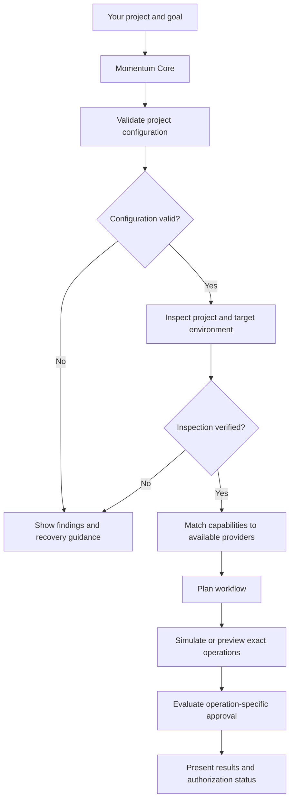
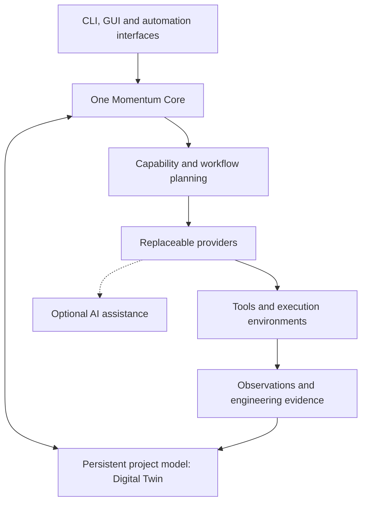

# How Momentum works

Workflow and architecture reference · October 27, 2026

Momentum uses one shared core engine to turn a software project and engineering goal into an inspected, explainable workflow. The current CLI supports inspection, simulation, planning and authorization previews. These paths do not dispatch live operations.

## Current workflow

This is a conceptual sequence across available commands; it does not claim every command performs every stage. Configuration validation and verified inspection gate workflow planning. Simulation and authorization preview are distinct supported paths.

| Stage | What Momentum does | What you can review |
| --- | --- | --- |
| Validate | Checks the project manifest before contacting the target. | Validation findings and recovery guidance. |
| Inspect | Examines the target environment. | A verified, failed or unavailable inspection outcome. |
| Plan | Resolves providers for required capabilities. | An explainable workflow plan. |
| Simulate / preview | Displays proposed operations. | Simulation output or an exact authorization request. |
| Evaluate approval | Checks authority against the prepared operation. | The approval decision and any blocking reason. |
| Review | Presents results and diagnostics. | Evidence for the next decision, without live CLI dispatch. |

### Decision boundaries

- Invalid manifests stop before target inspection.
- Failed or unavailable target inspection stops workflow planning before provider resolution; diagnostics remain visible.
- Approval must bind to the exact prepared operation. Missing, denied, expired, stale or mismatched authority stays blocked.
- Current CLI inspection, simulation and authorization previews do not dispatch live operations.
- `momentum apply` and `momentum repair apply` are unavailable in documented 1.0 behavior pending their protected attempt and recovery lifecycles.
- `momentum verify` is unavailable in documented 1.0 behavior because repository test execution remains outside the protected execution boundary. Inspection and preview do not run repository tests.

## Architectural direction

The Digital Twin is the intended persistent engineering model: project artifacts, dependencies, capabilities, workflows, history, observations and derived knowledge. The complete persistent Digital Twin is architectural direction, not a claim that every planned capability is implemented.

Capabilities describe engineering intent; providers implement capabilities. AI is an optional provider, rather than the architecture itself. Local process, SSH and artifact-transfer collaborators have implementation foundations; unrestricted live CLI execution is not exposed by that fact. Interface and provider availability must be assessed individually.

## Product and development machinery

Momentum Core is the product engine. Scout, Travel, Nightly, CT200 supervision and the R9700 are development machinery used to build and evaluate Momentum. Their capabilities and internal machine topology are not customer feature promises.

## Source and publication notes

Grounded in the canonical Swift repository README read on October 27, 2026 at commit `448ed62e6323d79245e0715464a674df1c6765c4`. This records that source snapshot; it does not assert parity with the latest primary branch or release qualification.

The temporary website presents the same workflow, table and architecture with native HTML and CSS. It retains the distinction between current CLI behavior, implemented foundations and architectural direction. This documentation does not authorize execution, deployment or model spending.
